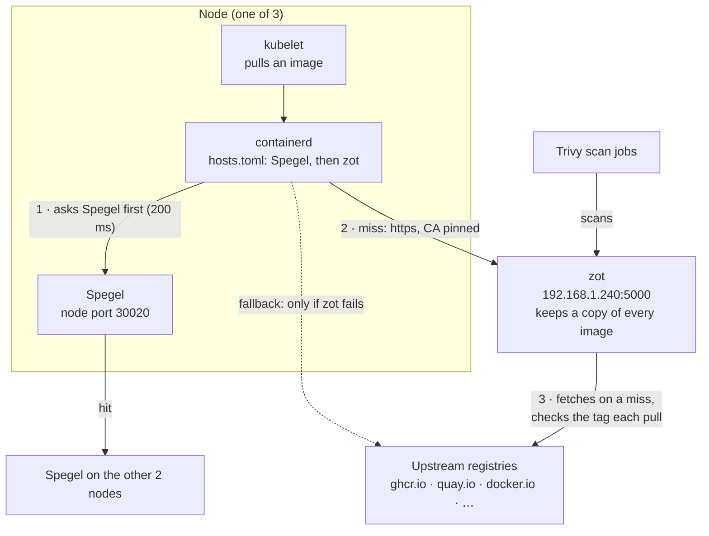

# Registry mirrors on the nodes

Image pulls on a node go containerd, then Spegel, then zot, then the upstream registry. This is how it looks once the Spegel
values from `k8s/infra/registry-system/spegel/` are applied and the Spegel pods have restarted:



Until the Spegel values are applied, and again after a Talos registry patch until the pods restart, containerd skips Spegel
and goes to zot directly (step 1 is missing).

- containerd reads `/etc/cri/conf.d/hosts/<registry>/hosts.toml`. Talos writes these files from `patches/11-zot-mirrors.yaml`
  (seven registries, each pointing at its zot cache over https, with the root CA pinned). Spegel's init container
  (`k8s/infra/registry-system/spegel/`) saves them to `_backup` once and rewrites each file as Spegel first, then the saved hosts.
- Spegel answers from the other nodes. A miss moves on to zot (`192.168.1.240:5000`), which fetches from the internet when it
  has to and keeps a copy. Containerd goes straight to the upstream registry only when zot fails.
- The certificate zot serves comes from `certificate-cluster-issuer` and lists `192.168.1.240`. The CA certificate in the patch
  is the public part of `portableinfo-root-ca` (valid until 2036-11-07); replace it there if the CA is ever issued again.

## After changing a Talos registry patch

Talos rewrites the seven files on every change of its registry or CRI configuration (also at boot) and deletes everything else
in that directory, including Spegel's `_backup`. Spegel then drops out of the chain until its init container runs again:

1. Apply the patch to the nodes.
2. Restart Spegel: `kubectl -n registry-system rollout restart ds/spegel` (one pod at a time). The PodSecurity warning it prints is only a
   warning: Spegel needs hostPath volumes and root.
3. Check the init log of each new pod: `kubectl -n registry-system logs spegel-<id> -c configuration` shows
   `backing up containerd host configuration` and `prepending to existing containerd mirror configuration` for the seven registries.

## Checking that pulls take the whole path

- zot: `zot_repo_downloads_total` rises for a `ghcr-cache/…` repository that only kubelet pulls, for example
  `ghcr-cache/cthtrifork/talos-gitops/vex-cache`.
- Spegel: `spegel_mirror_requests_total` rises for the same registry (hit or miss). Without Spegel in the chain only the zot counter moves.
- A pull that skips zot shows no zot download and the image still arrives from the internet, so a failure here does not break pulls.
- Spegel's mirror is a NodePort, so a pull on one node can be counted on any Spegel pod. Compare the sum over the pods with the
  pulls of the node you are testing, and look at the scan pods' `nodeName` to know which node that is.

## Testing a miss on every node

Tested on 10 Nov 2026 with a pod that pulls an image no node has. Use a different tag per node, because a node that already
pulled a tag lets Spegel answer the others from it (a hit, which does not reach zot):

```sh
kubectl run pull-test  --restart=Never --image=mirror.gcr.io/library/busybox:1.36.1 --overrides='{"spec":{"nodeName":"talos-2ny-8tx"}}' -- true
kubectl run pull-test2 --restart=Never --image=mirror.gcr.io/library/busybox:1.36.0 --overrides='{"spec":{"nodeName":"talos-tba-msi"}}' -- true
kubectl run pull-test3 --restart=Never --image=mirror.gcr.io/library/busybox:1.35.0 --overrides='{"spec":{"nodeName":"talos-11a-esj"}}' -- true
```

The pods run in the namespace you are in (`kubectl -n default get pod pull-test`); delete them afterwards. What a working chain shows:

- the pod's `Pulled` event within a few seconds, with no `ErrImagePull`;
- zot's log (`kubectl -n registry-system logs zot-0`) has `Copy layer`, `pushing synced local image to local registry` and
  `successfully synced image` for `docker-hub-cache/library/busybox`, then the tag;
- `spegel_mirror_requests_total{registry="mirror.gcr.io",cache="miss"}` rises. The series only exists after its first request, so a
  query that compares the first and last value of a window misses it; read the current value.

`zot_repo_downloads_total` did not move for these pulls although the log shows the sync. Trust the log.

## Checking each node

Patch 11 is applied per node. The init log of a new Spegel pod shows what its node had when the pod started:
`kubectl -n registry-system logs spegel-<id> -c configuration`.

- A node with the patch logs `backing up containerd host configuration` for the seven registries and for `192.168.1.240_5000_`
  (the TLS directory), then `prepending to existing containerd mirror configuration` seven times.
- A node without those backup lines had no Talos files when Spegel last started, or kept an older saved copy. Its pulls skip zot
  and go from Spegel to the upstream registry. Apply the patch to that node and restart its Spegel pod.
- The pull test only proves the node that pulled. Scan pods all ran on one node, so they say nothing about the others.

## Zot settings behind this path

`k8s/infra/registry-system/zot/zot.json`:

- one sync entry per registry, each `onDemand` with `tlsVerify`, `maxRetries: 1` and `retryDelay: 5s`, so an unreachable upstream
  fails in seconds and zot serves the copy it has. Repository names are the cache name plus the image path, for example
  `ghcr-cache/cthtrifork/talos-gitops/vex-cache`. `docker-hub-cache` serves both `docker.io` and `mirror.gcr.io`.
- the `ghcr-private` entry also polls `cthtrifork/**` every 12 hours, which mirrors every tag of every repository under it.
  Nothing in the node pull path reads those repositories, but they take most of the disk.
- retention keeps the newest tag of every repository and, with `keepUntagged`, the newest and the most recently pulled untagged
  manifest, so digest-pinned images stay available without internet.

## Going back to Spegel alone

Revert the Spegel values (`mirroredRegistries: []`, `prependExisting: false`), then restart the Spegel pods. Spegel writes one
`_default` mirror again and zot is used by Trivy only.
