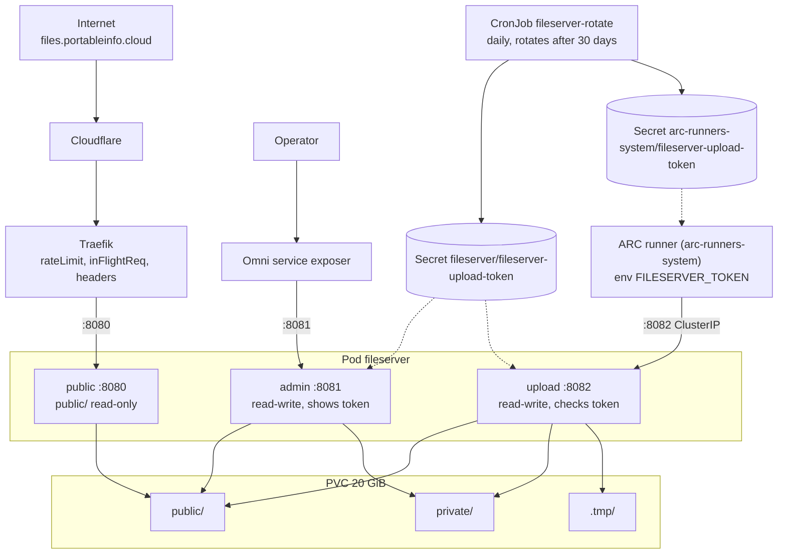

# fileserver

A small file server for the homelab cluster. First use: `homeserver-bootc` uploads its disk images here instead of to Azure.
One static Go binary with no third-party dependencies, four modes. State is the directory a file is in, so there is no database.

| Mode | Port | Mounts | What it does |
|---|---|---|---|
| `--mode=public` | 8080 | `public/` read-only | `GET /<name>` only. No listing, no other methods. Exposed through Traefik and the Cloudflare tunnel (`files.portableinfo.cloud`) |
| `--mode=admin` | 8081 | whole volume, token Secret | List, upload, download, delete, move between public and private, and show the upload token. No login of its own: only the Omni service exposer reaches it |
| `--mode=upload` | 8082 | whole volume, token Secret | `PUT /v1/files/<name>?visibility=public\|private` for CI with the rotating bearer token. Cluster-internal only |
| `--mode=rotate` | none | none | CronJob: creates and rotates the upload token Secret in the fileserver and runner namespaces |

The public container cannot see `private/` or the token at all, so a bug there cannot leak either.



## Rules

- **Names:** flat, `^[A-Za-z0-9_][A-Za-z0-9._-]{0,127}$`. No dotfiles, no paths. Every access goes through `os.Root`.
- **Visibility is the directory.** A name exists in at most one of `public/` and `private/`. Uploading it with the other visibility returns 409. Uploading it again with the same visibility replaces it (CI always overwrites). Uploads default to private.
- **Atomic writes.** A file is streamed to `.tmp/` and renamed into place after `fsync`, so a half upload is never visible and never replaces a good file. Leftovers in `.tmp/` are removed at start-up.
- **Limits.** `MAX_FILE_BYTES` (8 GiB) per file: 413. Free space must stay above `MIN_FREE_BYTES` (256 MiB) plus the announced size: 507.
- **Integrity.** An optional `X-Content-SHA256` header (hex) on the upload makes the server hash the body while writing and refuse a mismatch with 422 before the rename, so a truncated or corrupted image never replaces a good one. A malformed value is 400.
- **Downloads are never pages.** `Content-Type: application/octet-stream`, `Content-Disposition: attachment`, `nosniff`, `CSP: sandbox`.
- **Admin CSRF.** State-changing admin calls, and the token call, need the header `X-Requested-With: fileserver`.

## Upload token

One random token (`fs_` + 64 hex characters) in the Secret `fileserver-upload-token`, with the keys `current`, `previous` and `rotated-at`.

- **Created and rotated by the CronJob** (`--mode=rotate`), which runs daily and rotates when `rotated-at` is older than `ROTATE_AFTER` (30 days). It writes the same data to every namespace/name in `ROTATE_TARGETS` and repairs a missing or edited copy without rotating.
- **Readers:** the admin and upload containers mount the Secret as files and re-read them on each request, so a rotation arrives within about a minute without a restart. ARC runners get `current` as an environment variable at pod start (ARC runners are ephemeral, so each job starts with the current token).
- **Grace period:** the previous token is also accepted for `PREVIOUS_TOKEN_GRACE` (24 h) after a rotation, so a job that started just before a rotation can still upload.
- **Only the upload API accepts it.** The public and admin handlers ignore the header. The upload port is a ClusterIP Service that a NetworkPolicy opens only to the runner namespace.
- **Visible in the admin panel** (Show / Copy), together with the rotation time.

**Trade-off:** every job on a runner that receives the token can upload to the fileserver, not only `homeserver-bootc`. With GitHub OIDC the repository was checked. Keep the runners private and treat anything that runs on them as trusted. A job that echoes the token into its log leaks it, so workflows should add `::add-mask::`.

Upload from a workflow (the file is `$FILE`):

```yaml
- run: |
    echo "::add-mask::$FILESERVER_TOKEN"
    SUM=$(sha256sum "$FILE" | cut -d" " -f1)
    curl --fail --retry 3 --retry-all-errors --max-time 3600 -T "$FILE" \
      -H "Authorization: Bearer $FILESERVER_TOKEN" -H "X-Content-SHA256: $SUM" \
      "http://fileserver-upload.fileserver.svc:8082/v1/files/$(basename "$FILE")?visibility=private"
```

## Configuration (environment)

| Variable | Default | Modes |
|---|---|---|
| `DATA_DIR` | `/data` | admin, upload |
| `PUBLIC_DIR` | `$DATA_DIR/public` | public |
| `LISTEN_ADDR` | `:8080` / `:8081` / `:8082` | public, admin, upload |
| `HEALTH_ADDR` | `:9102` (`/healthz`, process only) | public, admin, upload |
| `MAX_FILE_BYTES` | `8589934592` | admin, upload |
| `MIN_FREE_BYTES` | `268435456` | admin, upload |
| `TOKEN_DIR` | `/var/run/fileserver-token` | admin, upload |
| `PREVIOUS_TOKEN_GRACE` | `24h` | admin, upload |
| `ROTATE_TARGETS` | none, required: `namespace/name,namespace/name`, the first decides when to rotate | rotate |
| `ROTATE_AFTER` | `720h` | rotate |

The rotator uses the pod's ServiceAccount token and CA. Its RBAC is `get`, `create` and `update` on Secrets, limited to the target namespaces. It needs nothing else.

## Layout

```
images/fileserver/
├── Dockerfile        builder runs the tests, final image is scratch + CA certificates, user 65532
├── main.go           flags, environment, servers, shutdown
├── store.go          names, put/list/delete/move on public/ private/ .tmp/
├── token.go          reads the mounted token, current/previous with grace
├── rotate.go         the CronJob: creates and rotates the Secret through the Kubernetes API
├── handlers.go       public, admin and upload handlers
├── web/index.html    the admin page (embedded, no framework)
└── fileserver_test.go
```

## Roadmap

1. This image (`build-image.yaml` builds, signs and publishes it).
2. `k8s/apps/fileserver/`: namespace, 20 GiB `local-path` PVC, Deployment with `subPath` mounts, Services (admin with Omni annotations), IngressRoute, NetworkPolicies, the CronJob with a Role and RoleBinding in each target namespace, a first one-off run, and an egress rule for `arc-runners-system` to the upload port. The runner scale set gets `FILESERVER_TOKEN` from the Secret.
3. `homeserver-bootc`: replace the Azure upload in `create-vmdk-image.yaml` with the upload above, and run it on `arc-ubuntu`.

Run the tests with `go test -race ./...` in this directory.
