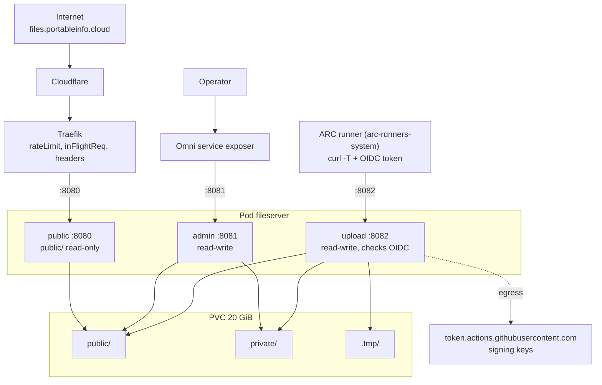

# fileserver

A small file server for the homelab cluster. First use: `homeserver-bootc` uploads its disk images here instead of to Azure.
One static Go binary, three modes, one container each in the same pod. State is the directory a file is in, so there is no database.

| Mode | Port | Mounts | What it does |
|---|---|---|---|
| `--mode=public` | 8080 | `public/` read-only | `GET /<name>` only. No listing, no other methods. Exposed through Traefik and the Cloudflare tunnel (`files.portableinfo.cloud`) |
| `--mode=admin` | 8081 | whole volume | List, upload, download, delete, and move between public and private. No login of its own: only the Omni service exposer reaches it |
| `--mode=upload` | 8082 | whole volume | `PUT /v1/files/<name>?visibility=public\|private` for CI, authenticated with a GitHub Actions OIDC token. Cluster-internal only |

The public container cannot see `private/` at all, so a bug cannot leak a private file.



## Rules

- **Names:** flat, `^[A-Za-z0-9_][A-Za-z0-9._-]{0,127}$`. No dotfiles, no paths. Every access goes through `os.Root`.
- **Visibility is the directory.** A name exists in at most one of `public/` and `private/`. Uploading it with the other visibility returns 409. Uploading it again with the same visibility replaces it (CI always overwrites). Uploads default to private.
- **Atomic writes.** A file is streamed to `.tmp/` and renamed into place after `fsync`, so a half upload is never visible and never replaces a good file. Leftovers in `.tmp/` are removed at start-up.
- **Limits.** `MAX_FILE_BYTES` (8 GiB) per file: 413. Free space must stay above `MIN_FREE_BYTES` (256 MiB) plus the announced size: 507.
- **Downloads are never pages.** `Content-Type: application/octet-stream`, `Content-Disposition: attachment`, `nosniff`, `CSP: sandbox`.
- **Admin CSRF.** State-changing admin calls need the header `X-Requested-With: fileserver`.

## Upload authentication

No static secret. The workflow requests a GitHub OIDC token for the audience `fileserver` and sends it as the bearer. The server checks the signature (keys fetched from the issuer and cached), issuer, audience and expiry, then that the `repository` claim is in `ALLOWED_REPOS`. Any ref of an allowed repository is accepted. No token or a bad one: 401. A valid token from another repository: 403. The issuer is discovered on first use, so the pod stays healthy while GitHub is unreachable.

```yaml
permissions:
  id-token: write
steps:
  - run: |
      TOKEN=$(curl -sf -H "Authorization: Bearer $ACTIONS_ID_TOKEN_REQUEST_TOKEN" \
        "$ACTIONS_ID_TOKEN_REQUEST_URL&audience=fileserver" | jq -r .value)
      curl --fail -T "$FILE" -H "Authorization: Bearer $TOKEN" \
        "http://fileserver-upload.fileserver.svc:8082/v1/files/$(basename "$FILE")?visibility=private"
```

## Configuration (environment)

| Variable | Default | Modes |
|---|---|---|
| `DATA_DIR` | `/data` | admin, upload |
| `PUBLIC_DIR` | `$DATA_DIR/public` | public |
| `LISTEN_ADDR` | `:8080` / `:8081` / `:8082` | all |
| `HEALTH_ADDR` | `:9102` (`/healthz`, process only) | all |
| `MAX_FILE_BYTES` | `8589934592` | admin, upload |
| `MIN_FREE_BYTES` | `268435456` | admin, upload |
| `OIDC_ISSUER` | `https://token.actions.githubusercontent.com` | upload |
| `OIDC_AUDIENCE` | `fileserver` | upload |
| `ALLOWED_REPOS` | none; required, the upload mode refuses to start without it | upload |

## Layout

```
images/fileserver/
├── Dockerfile        builder runs the tests, final image is scratch + CA certificates, user 65532
├── main.go           flags, environment, servers, shutdown
├── store.go          names, put/list/delete/move on public/ private/ .tmp/
├── auth.go           OIDC token check and repository allowlist
├── handlers.go       public, admin and upload handlers
├── web/index.html    the admin page (embedded, no framework)
└── fileserver_test.go
```

## Roadmap

1. This image (`build-image.yaml` builds, signs and publishes it).
2. `k8s/apps/fileserver/`: namespace, 20 GiB `local-path` PVC, Deployment with `subPath` mounts, Services (admin with Omni annotations), IngressRoute, NetworkPolicies, and an egress rule for `arc-runners-system` to the upload port.
3. `homeserver-bootc`: replace the Azure upload in `create-vmdk-image.yaml` with the upload above, and run it on `arc-ubuntu`.

Run the tests with `go test -race ./...` in this directory.
