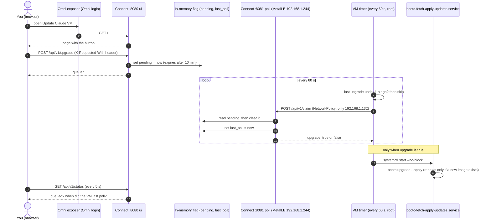

# claude-system

Claude Code **Remote Control** with read-only cluster access and an egress whitelist. The pod runs
`claude remote-control` under your own claude.ai login (stored on a PVC), so the session appears at
claude.ai/code. No admin settings or environment key are needed. Docs: <https://code.claude.com/docs/en/remote-control>.

| File | What |
|---|---|
| `rbac.yaml` | ServiceAccount `claude`; built-in `view` (no Secrets) plus read-only access to nodes, storage, CRDs and the CRD groups in use (including MetalLB, the ARC runner resources and the trivy-operator reports). No write verbs, no `pods/exec` |
| `networkpolicy.yaml` | Cilium default deny, then DNS, the Kubernetes API and TCP 443 to the hosts Claude Code needs |
| `github-app.yaml` | CronJob that mints a one-hour GitHub App installation token into `claude-github-token` (scripts in `github-app/`) |
| `deployment.yaml` | `claude-rc`: idles until a login exists, then runs `claude remote-control`; non-root, read-only root filesystem |
| `claude-md/CLAUDE.md` | The only `CLAUDE.md` (user-level and repo notes together), generated into the `claude-md` ConfigMap by `kustomization.yaml` and symlinked to `~/.claude/CLAUDE.md` at pod start. Edit it in Git; the ConfigMap name hash rolls the pod |
| `claude-md/skills/<name>/SKILL.md` | Task-specific runbooks split out of `CLAUDE.md`, generated into the `claude-skills` ConfigMap and mounted at `/etc/claude-skills` (items map each key to `<name>/SKILL.md`); each is symlinked into `~/.claude/skills/` at pod start |
| `usage/` | Usage page and JSON API out: `usage.yaml` (a second Redpanda Connect), `redpanda-connect.yaml` (PromQL behind each endpoint), `index.html` (the page) |
| `vm-upgrade/` | "Update Claude VM" button: `vm-upgrade.yaml` (a third Redpanda Connect), `redpanda-connect.yaml` (the flag and its two listeners), `index.html` (the button) |
| `pvc.yaml` | 5Gi volume holding the login (`/home/claude`); delete it to sign out |
| `../../../images/claude-runner/` | Image: Anthropic publishes none, so this wraps the `claude` binary (checksum verified) plus `kubectl`, `gh`, `crane`, the Flux MCP server and a git credential helper |

## 1. Build the image

Run the **Publish to Github** workflow (`workflow_dispatch`, tag prefix `rc`) or push a `v*` tag. It
publishes `ghcr.io/cthtrifork/talos-gitops/claude-runner:<tag>`. Put that tag, pinned by digest,
in `deployment.yaml`. Renovate bumps `CLAUDE_CODE_VERSION` in the Dockerfile; the checksum is read from the release manifest at build time
(checksum: `https://downloads.claude.ai/claude-code-releases/<version>/manifest.json`, `linux-x64`).

## 2. GitHub access for git

The pod reads a token from the Secret `claude-github-token` and hands it to git for `github.com` only
(the image's `gh` wrapper reads the same file, so the pod can push branches and open PRs; `api.github.com` is in the egress allowlist). A GitHub App keeps that Secret
fresh, with a token that expires every hour.

`github-app.yaml` runs a CronJob that signs a JWT with the App's private key and exchanges it for a
one-hour installation token, with everything the App was granted on the repositories it is installed on (the request is not narrowed,
so scope it in the App's settings). The pod holds only that short-lived token.

1. Create the App (GitHub: Settings > Developer settings > GitHub Apps > New). Repository permissions:
   **Contents: read and write**, **Pull requests: read and write**, **Workflows: read and write**,
   **Metadata: read**. Leave everything else off. **Workflows** lets the App push changes under
   `.github/workflows/`; turn it off in the App's settings to forbid that. Untick "Webhook active". Never make it a bypass actor in a ruleset.
2. Generate a private key (downloads a `.pem`), install the App only on the repositories Claude should reach, and note the
   **App ID** (App settings page) and the **installation ID** (the number at the end of the installation's
   URL, `https://github.com/settings/installations/<id>`).
3. Create the credentials Secret `claude-github-app` as a SOPS-encrypted file (command and key rotation: "Secrets (SOPS)" in the root `readme.md`).

4. Run the first refresh now instead of waiting for the schedule, and check it:

```sh
kubectl -n claude-system create job --from=cronjob/claude-github-token first-token
kubectl -n claude-system logs job/first-token -c refresh      # "claude-github-token refreshed"
kubectl -n claude-system get secret claude-github-token
```

If the Job fails, look at `kubectl -n claude-system logs job/first-token -c sign-jwt` and
`kubectl -n claude-system describe job first-token`. Git pushes fail until the Secret exists (the pod itself starts without it).

`claude-github-app` is `claude-github-app.enc.yaml`; add it to `kustomization.yaml` `resources:` the first time.

### Pull token for private images (optional)

`crane` in the pod reads private ghcr.io packages through a Docker config from the Secret `ghcr-pull`, mounted at
`/etc/registry-auth/config.json` with `DOCKER_CONFIG=/etc/registry-auth`. Create it as a SOPS-encrypted file (command and rotation: "Secrets (SOPS)" in the root `readme.md`) from a token that has
**only `read:packages`**, so the pod can read but never push (the pod starts without it).

## 3. Sign in once

The pod idles and logs "not logged in" until a login exists:

```sh
kubectl -n claude-system exec -it deploy/claude-rc -- claude
```

Run `/login`, open the URL on your own machine, paste the code back, then `/exit`. Within 30 seconds the
pod starts `claude remote-control` and the session appears at <https://claude.ai/code>. The login and
its token refreshes stay on the PVC, so restarts need no new login. To sign out, delete the
`claude-home` PVC. The PVC holds your login: anyone with node access can act as you.

## Flux MCP server

The image carries `flux-operator-mcp` (<https://fluxcd.control-plane.io/mcp/>). The deployment registers it as the
user-scoped MCP server `flux` at every start, in read-only mode (`--read-only`: no reconcile, suspend, resume or
apply tools). It uses the pod's in-cluster ServiceAccount, so it can read no more than `rbac.yaml` allows. Check
with `claude mcp list` in the pod. No egress change is needed, it only talks to the Kubernetes API.

## Check what the pod can and cannot do

```sh
SA=system:serviceaccount:claude-system:claude
kubectl auth can-i list pods -A --as=$SA                          # yes
kubectl auth can-i list clusters.postgresql.cnpg.io -A --as=$SA   # yes
kubectl auth can-i get secrets -A --as=$SA                        # no
kubectl auth can-i delete pods -A --as=$SA                        # no
kubectl auth can-i create pods/exec -A --as=$SA                   # no
```

Anything the pod reads from the cluster (logs, events, annotations) is input Claude acts on, so keep
the App installed only on the repositories Claude needs and its permissions minimal; the token is not narrowed beyond that. The `claude` ServiceAccount cannot read Secrets through the
API, but the GitHub token and your claude.ai login are in this pod, so treat the pod as holding both.

## Usage telemetry

Claude Code exports OpenTelemetry metrics (tokens, cost, sessions, lines of code, commits, pull requests, active time) from
`claude-rc` and from the Claude VM ([homeserver-bootc](https://github.com/cthtrifork/homeserver-bootc)) straight into the
cluster Prometheus, through its OTLP receiver (`enableOTLPReceiver` in `k8s/infra/kube-prometheus-stack/helm-release.yaml`).
Both send `environment=<name>` as a resource attribute (`claude-rc`, `claude-vm`), which is promoted to a label.

Both senders set exactly these variables (`claude-rc` in `deployment.yaml`, the VM in homeserver-bootc `managed-settings.json`);
only the endpoint and the environment name differ:

| Variable | Value | Why |
|---|---|---|
| `CLAUDE_CODE_ENABLE_TELEMETRY` | `1` | switches the exporter on; independent of `DISABLE_TELEMETRY=1` (Datadog and error reporting) |
| `OTEL_METRICS_EXPORTER` | `otlp` | |
| `OTEL_EXPORTER_OTLP_PROTOCOL` | `http/protobuf` | what Prometheus' receiver takes |
| `OTEL_EXPORTER_OTLP_ENDPOINT` | VM: `http://otel.portableinfo.cloud/api/v1/otlp`; `claude-rc`: `http://kube-prom-prometheus.kube-prometheus-stack-system.svc:9090/api/v1/otlp` | Claude Code appends `/v1/metrics`; the pod stays inside the cluster, so its telemetry does not depend on Cloudflare DNS or the load balancer address |
| `OTEL_EXPORTER_OTLP_METRICS_TEMPORALITY_PREFERENCE` | `delta` | the default is cumulative, and with `session_id` off several `claude` processes (the VM has several sessions and two users) would write the same series with different totals; deltas add up |
| `OTEL_RESOURCE_ATTRIBUTES` | `environment=claude-rc` / `claude-vm` | promoted to a label |
| `OTEL_METRICS_INCLUDE_SESSION_ID` | `false` | see the labels note below |
| `OTEL_METRICS_INCLUDE_ACCOUNT_UUID` | `false` | constant, so no use as a label |

- **Receiver:** `otel.portableinfo.cloud` is a Cloudflare A record `otel` -> `192.168.1.243` (DNS only): the MetalLB address of
  `prometheus-otlp-lb`, plain HTTP on 80, because the VM's egress gateway forwards HTTP by `Host`. LAN only, no ingress, no
  authentication; the same Service reaches the whole Prometheus HTTP API (the admin API is off). `claude-rc` uses the in-cluster
  service instead (its policy allows Prometheus on 9090).
- **Delta counters:** `otlp-deltatocumulative` adds them up in memory, so a Prometheus restart starts the counters at 0
  (`increase()` copes with that).
- **Names:** `otlp.translationStrategy: UnderscoreEscapingWithoutSuffixes` gives `claude_code_token_usage{environment,model,type}`,
  `claude_code_cost_usage{environment,model}` (USD), and `claude_code_session_count`, `claude_code_lines_of_code_count{type}`,
  `claude_code_commit_count`, `claude_code_pull_request_count`, `claude_code_active_time_total` (seconds), all with `environment`.
  Example, USD per day: `sum by (environment,model)(increase(claude_code_cost_usage[1d]))`.
- **Retention:** 30 days on a 20Gi volume (`retentionSize` 16GiB). To afford it, histogram buckets are dropped from the apiserver,
  kubelet and Dependency-Track scrapes (they were 104k of 193k series); `_sum` and `_count` stay, percentiles of those are gone.
  `local-path` does not enforce the volume size; watch `NodeFilesystemAlmostFull` for the node.
- Claude Code sends its attributes on every datapoint and Prometheus keeps them all as labels: besides `environment`, `model` and
  `type` also `user_email`, `user_id`, `organization_id`, `terminal_type`, `effort` and `query_source`. They are kept: with one or two
  users they cost nothing, and they allow a per-user split. `session_id` and `user_account_uuid` are switched off with
  `OTEL_METRICS_INCLUDE_SESSION_ID=false` and `OTEL_METRICS_INCLUDE_ACCOUNT_UUID=false`, for accuracy rather than size: every session
  would be its own cumulative series, `increase()` cannot see the first export of a series, and a session that exports once or twice
  would count as zero (`increase(claude_code_session_count[1h])` came back empty). Series stored before that keep their `session_id`.
  The usage API always sums by `environment`, so it is unaffected by the extra labels.

### Usage page and API

`usage/usage.yaml` is a Redpanda Connect that holds no data: every request becomes PromQL against Prometheus.
It is exposed through the Omni service exposer (`omni-kube-service-exposer.sidero.dev/*` on `Service/claude-usage`, port
50091, plain HTTP, LAN only, read-only, aggregates only).

| Request | Answer |
|---|---|
| `GET /` | the page (`usage/index.html`: totals, per-day columns by environment, cost and token mix by model, tables) |
| `GET /api/v1/summary` | today (since 00:00 UTC), 7d and 30d: total and per environment |
| `GET /api/v1/daily?days=30` | cost, tokens, sessions, commits and pull requests per UTC day and environment (2-90 days, today included) |
| `GET /api/v1/breakdown?window=7d` | tokens, cost and lines changed per environment and model (`today`, `7d`, `30d`) |
| `GET /api/v1/decisions?window=7d` | edit tool decisions per environment, tool, decision, language and source (top 50) |
| `GET /healthz` | `ok` |

A failed Prometheus query answers `502`. Query parameters are clamped numbers or picked from a list, never PromQL text.
Only series Prometheus holds are shown. Tokens, cost and lines have a `model` label; sessions, commits, pull requests and active
time do not, so they are per environment only (and so is cost per commit). The page script is plain JavaScript with no external assets; the numbers are `increase()` over
the window, so the very first export of a new model or environment is not counted.
From `claude-rc`: `curl -s http://claude-usage.claude-system.svc/api/v1/summary`.

## Update Claude VM button

`vm-upgrade/` holds a Redpanda Connect with one in-memory flag and two listeners. The VM polls the flag and runs
`bootc upgrade --apply` itself (units in [homeserver-bootc](https://github.com/cthtrifork/homeserver-bootc)); the cluster never
connects to the VM and never sends it a command.



| Listener | Reached through | Endpoints |
|---|---|---|
| `:8080` page | Omni service exposer, `Service/claude-vm-upgrade` (port 50092, behind Omni login) | `GET /` the button, `GET /api/v1/status`, `POST /api/v1/upgrade` (needs the header `X-Requested-With: vm-upgrade-button`, so a form on another site cannot post it) |
| `:8081` poll | MetalLB `claude-vm-upgrade-lb`, 192.168.1.244, plain HTTP, only from the VM | `POST /api/v1/claim`: answers `{"upgrade": true}` once per click, then clears the flag |

The flag lives 10 minutes and is cleared by the first claim, so one click is at most one upgrade; a pod restart drops an unclaimed click.
The poll listener has no way to queue an upgrade, and the page listener has no `claim`.

There is no token. The poll listener is reachable only from the VM's static address: `CiliumNetworkPolicy/claude-vm-upgrade` allows
`192.168.1.132/32` on 8081, and the LoadBalancer Service uses `externalTrafficPolicy: Local` so Cilium sees the VM's address and not a
node's. This is weaker than a secret: a host on the same LAN segment that spoofs 192.168.1.132 could claim a click (or poll as the VM), and
the VM's poll is plain HTTP, so a host in the path could answer `{"upgrade": true}` (bounded by the VM's one-upgrade-per-hour limit).
If the VM's address changes, change the `/32` in `networkpolicy.yaml`.

On the VM, as root, tell the timer where to poll (the unit is skipped until the file exists):

```sh
install -d -m 0700 /etc/claude-vm/upgrade
printf %s http://192.168.1.244 > /etc/claude-vm/upgrade/url
```

Check from the VM: `curl -s -XPOST http://192.168.1.244/api/v1/claim` answers `{"upgrade":false}` while nothing is queued (from any other address the request times out).
The page shows when the VM last polled, so a dead timer is visible.
